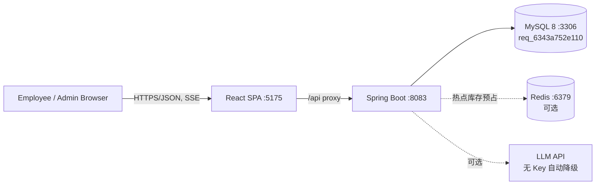

# WeBox — 企业员工餐食订购平台

前后端分离的员工餐食订购系统：员工浏览每日菜单、配置菜品选项、加购、按截单规则下单、取消订单、管理饮食偏好并使用 AI 选餐；管理员通过 Console 管理菜品、每日菜单/库存、订单、审计、AI 规则与经营看板。

- 后端：Java 17 + Spring Boot 3.3 + MySQL 8（独立进程，不使用 H2/SQLite）+ JdbcTemplate + Spring Security(JWT)
- 前端：React 18 + TypeScript + Vite + Zustand + React Router
- 金额：全链路整数分（BIGINT cents），服务端按数据库单价重算，展示 `¥22.50`
- 用户可见文案：英文（PRD 要求）；代码注释与交付文档：中文

> 文档结构：`docs/` 为交付文档正文（原 `doc/` 已迁移至此，含 00-08 + README）；`docs/raw/` 保留 PRD 原文、分析底稿、交叉评审、缺陷台账、各版本测试/验收报告与参考 wiki。用户↔Agent 对话、Agent 协作记录、Claude Code 原始 transcript 见 [`ai-conversations/`](ai-conversations/README.md)。

---

## 1. 功能范围

### Tier 1 核心（必做）
| 能力 | 说明 |
|---|---|
| 注册 / 登录 | 邮箱 + 密码（8–64 位且含字母数字）；BCrypt；JWT access 2h + refresh 7d 轮换；登录限流 |
| 每日菜单 | 当日菜单、分类多选、关键词搜索、稳定排序、分页；菜品详情含描述/蛋白质/过敏原/辣度/选项组 |
| 购物车 | 本地持久化；同菜同配置合并、不同配置分行；每单总份数 ≤5；实时总价 |
| 下单 | 结算预览、地址簿、截单自动切换餐次、服务端重算金额、`Idempotency-Key` 幂等、库存原子占用、订单快照 |
| 我的订单 | 列表/详情/取消；仅本人可见；他人订单一律 404 防枚举 |
| 取消 | 仅 `Pending` 可取消；库存与流水只回补一次 |

### Tier 2 进阶（必做）
| 能力 | 说明 |
|---|---|
| 饮食偏好 | 过敏原、偏好菜系、辣度、口味、预算上下限、`For You` 软排序；过敏原加购弹窗提醒（不阻断） |
| 订餐规则 | 午餐 10:00 / 晚餐 15:00（Asia/Shanghai）截单；过点自动切最近可订餐次；同日同餐次唯一有效单；预算超限提示不阻断 |
| Console 菜品管理 | 菜品增改/上下架/图片上传、每日菜单与库存设置、高风险操作 `confirm + reason + audit` |
| 权限与审计 | `EMPLOYEE` / `ADMIN`；`/admin/**` 方法级授权；审计日志记录谁/何时/对象/前后值/原因/IP |

### Tier 3 挑战（可选，已实现）
| 能力 | 说明 |
|---|---|
| 实时库存 | SSE `/api/v1/menu/stream` 推送 `dishId + available`；失败降级 5s 轮询；DB 为唯一账本 |
| 库存策略 | `DB_ATOMIC` 条件扣减；热点菜 `REDIS_PREALLOC` 预占 + 整单补偿 + 30s 对齐；Redis 故障整单降级 DB |
| AI 推荐 | 确定性候选过滤（上架/库存/过敏原/近 7 天）→ 规则或 LLM 排序；SSE `meta→dish→reason→done`；无 Key 自动 `rule-based fallback` |
| 经营看板 | 今日订单/收入/状态分布、Top 菜品、午餐/晚餐、近 7 天趋势、低库存 |
| 对账 | `inventory_ledger` 与库存推导值零漂移；差异可审计调整（`ADJUST`） |

---

## 2. 技术栈与选型理由

| 层 | 选型 | 理由 / 权衡 |
|---|---|---|
| 前端 | React 18 + TS + Vite | 组件化、类型约束金额/契约字段；Vite 启动快，适合 2 小时交付与演示 |
| 状态 | Zustand + localStorage | 轻量，购物车/偏好可持久化；避免 Redux 样板代码 |
| 后端 | Spring Boot 3.3 + JDK 17 | 成熟的事务、校验、安全与调度能力；模块化单体满足 200 人规模，避免微服务过度设计 |
| 数据访问 | JdbcTemplate + 显式 SQL | 交易正确性要求 SQL 可控（条件更新、`INSERT IGNORE`、唯一约束、生成列） |
| 数据库 | MySQL 8 独立进程 | 唯一账本；生成列 + 唯一索引保证唯一有效单；`BIGINT` 分存金额 |
| 缓存 | Caffeine + 可选 Redis | Caffeine 缓存菜单静态字段；Redis 仅做库存热点预占，**DB 永远是库存账本** |
| 鉴权 | Spring Security + HMAC JWT | 无状态、易演示；refresh token 哈希落库并轮换 |
| 实时 | SSE | 单向库存推送，协议简单；失败降级轮询 |
| AI | OpenAI 兼容接口（可配置） | 无 Key 时规则降级，保证演示不依赖外部网络 |

---

## 3. 架构



- 前端 SPA → 后端 REST `/api/v1`（39 个端点）→ 独立 MySQL；Redis 可选，不参与最终账本。
- 模块化单体：`auth / menu / order / inventory / admin / ai / common`，单向依赖。
- 交易关键路径：`Idempotency-Key` 三段式事务（抢占记录 → 业务事务 → 完成快照）；库存条件更新 `WHERE total-reserved-sold >= n`；`active_key` 生成列 + 唯一索引保证同用户同日同餐次唯一有效单；取消/超时通过 `inventory_ledger` 唯一业务键保证只回补一次。
- 详细设计见 [`docs/01-architecture.md`](docs/01-architecture.md)、[`docs/02-detailed-design.md`](docs/02-detailed-design.md)、[`docs/04-data-model.md`](docs/04-data-model.md)。

---

## 4. 目录结构

```text
.
├── README.md                 # 本文件：项目说明 + 从零启动 + 飞书 wiki 全文
├── RUNBOOK.md                # 小队执行手册：时间盒、环境、默认决策 D1–D26
├── docs/                     # 项目文档（索引 docs/README.md；原 doc/ 已迁移至此）
│   ├── 00-prd.md             # 需求与 PRD 分析
│   ├── 01-architecture.md    # 架构设计
│   ├── 02-detailed-design.md # 后端 + 前端详细设计
│   ├── 03-api.md             # API 契约（39 端点、错误码、示例）
│   ├── 04-data-model.md      # 数据库设计（17 表、索引、约束）
│   ├── 05-testing.md         # 测试方案 / 用例 / 执行证据
│   ├── 06-deployment.md      # 从零部署与排障
│   ├── 07-delivery.md        # 交付范围、AC 覆盖、证据索引、演示脚本
│   ├── 08-team-process.md    # 小队流程 + 飞书 wiki 原文
│   └── raw/                  # 过程文档与原始证据（PRD/分析/评审/缺陷/测试/参考 wiki）
├── backend/                  # Spring Boot 3.3 / JDK17 工程（含 schema.sql 与种子）
├── frontend/                 # React 18 + TS + Vite 工程
├── tests/                    # API / 并发 / E2E 脚本
├── artifacts/                # 测试日志、截图、证据
└── ai-conversations/         # 对话记录：用户↔Agent、Agent 协作、Claude Code 原始 transcript + 原始 JSON
```

---

## 5. 从零启动

### 5.1 环境要求

| 项 | 值 |
|---|---|
| JDK | 17（`JAVA_HOME=/usr/lib/jvm/java-17-openjdk-amd64`） |
| Maven | 3.9+（本机 `/opt/maven/bin/mvn`） |
| Node | 20+（本机 `/opt/nvm/versions/node/v22.22.3/bin`） |
| MySQL | 8.0，`127.0.0.1:3306`，账号 `test / test123456` |
| Redis | 可选，`127.0.0.1:6379`（`REDIS_ENABLED=false` 时整单降级 DB） |

### 5.2 初始化数据库

```bash
export JAVA_HOME=/usr/lib/jvm/java-17-openjdk-amd64
export PATH=/opt/gem/bin:/opt/nvm/versions/node/v22.22.3/bin:$JAVA_HOME/bin:/opt/maven/bin:$PATH

mysql -h127.0.0.1 -utest -ptest123456 -e \
  "CREATE DATABASE IF NOT EXISTS req_6343a752e110 CHARACTER SET utf8mb4 COLLATE utf8mb4_0900_ai_ci;"
```

首次启动后端会自动执行 `backend/src/main/resources/db/schema.sql`，创建 17 张表并写入种子数据（20 道菜、选项组/选项、当日与未来 2 天菜单和库存、演示账号、AI 规则）。跨天演示前执行 `psql` 以外的脚本：`backend/scripts/reseed_today.sql`（MySQL 客户端执行）重建当日菜单。

Redis 可选，若本机可用：

```bash
redis-server --daemonize yes
redis-cli ping   # PONG
```

### 5.3 启动后端（标准 8080 / 本机实际 8083）

```bash
cd backend
/opt/maven/bin/mvn -DskipTests package

# 标准方式（8080 空闲时）
JWT_SECRET="$(openssl rand -hex 32)" \
MYSQL_DATABASE=req_6343a752e110 SERVER_PORT=8080 \
java -Duser.timezone=Asia/Shanghai -jar target/webox-backend.jar

# 本机实际验证方式：8080 被系统 nginx 占用，改用 8083
JWT_SECRET="$(openssl rand -hex 32)" \
MYSQL_DATABASE=req_6343a752e110 SERVER_PORT=8083 REDIS_ENABLED=true \
nohup java -Duser.timezone=Asia/Shanghai -jar target/webox-backend.jar \
  > ../artifacts/backend-8083.log 2>&1 &

curl -s http://127.0.0.1:8083/api/v1/health
# {"code":"OK","message":"OK","data":{"status":"UP","db":"UP","redis":"UP","cache":"UP"}}
```

常用环境变量：

| 变量 | 默认 | 说明 |
|---|---|---|
| `SERVER_PORT` | 8080 | HTTP 端口 |
| `MYSQL_HOST/PORT/USER/PASSWORD/DATABASE` | 127.0.0.1/3306/test/test123456/req_6343a752e110 | JDBC 连接 |
| `JWT_SECRET` | 空（启动随机生成） | 生产必须设置；未设置时重启后 token 失效 |
| `REDIS_ENABLED/HOST/PORT` | true/127.0.0.1/6379 | 热点库存预占；false 时全量 DB_ATOMIC |
| `LLM_API_KEY/BASE_URL/MODEL` | 空/OpenAI 默认 | 为空时 AI 规则降级 |
| `CORS_ORIGIN` | http://127.0.0.1:5173 | 允许来源；实际用 5175 时需覆盖 |
| `TEST_CLOCK_ENABLED` | false | 仅 test profile 允许 `X-Test-Clock` |

### 5.4 启动前端（标准 5173 / 本机实际 5175）

```bash
cd frontend
npm install

# 标准方式（5173 空闲、后端 8080）
npm run dev

# 本机实际验证方式：5173 被其他工作区占用，dev 用 5175，代理指向 8083
VITE_PROXY_TARGET=http://127.0.0.1:8083 VITE_DEV_PORT=5175 npm run dev
# → http://127.0.0.1:5175
```

生产构建：`npm run build`（先 `tsc --noEmit`，产物 `frontend/dist/`）。

### 5.5 演示账号

| 角色 | 邮箱 | 密码 |
|---|---|---|
| 管理员 | `admin@webox.com` | `Admin12345` |
| 员工 | `employee@webox.com` | `Employee123` |

以上为种子默认值（BCrypt cost 10 入库），仅用于本地演示；生产环境必须修改。员工也可在 `/register` 自行注册。

### 5.6 种子数据

- 20 道菜（含 `docs/raw/product_images/` 图片），16 个选项组、41 个选项；当日 + 未来 1/2 天菜单。
- 当日 9+ 道菜上架，库存 20–50 份，可直接下单、扣减、取消回补与看板演示。
- AI 规则配置初始版本 1；无 LLM Key 时走规则推荐。

---

## 6. 测试

```bash
# 后端单元 + 集成测试（测试库 req_6343a752e110_test，@ActiveProfiles("test")）
cd backend && /opt/maven/bin/mvn test

# 前端类型检查 + 生产构建
cd frontend && npm run typecheck && npm run build

# 接口冒烟（需先启动后端）
bash backend/scripts/smoke.sh

# 并发/幂等竞态（Node）
node tests/concurrency/order_race.mjs
node tests/concurrency/idempotency_race.mjs
```

已执行证据（Stage 5e 终版，详见 [`docs/05-testing.md`](docs/05-testing.md) §5.7 与 `artifacts/`）：

| 证据 | 结果 |
|---|---|
| `mvn test` | **17 tests, 0 failures, 0 errors**（UtilTest 6 + WeBoxApiIT 7 + S5bFixTest 4；`artifacts/s5b-backend-test.log`） |
| 并发抢购 50/10 | PASS：ready 50/50，201=10、409=40、`available=0`、ledger RESERVE=10（`artifacts/test-conc-order.log`） |
| 幂等 | PASS：3 并发 + 1 串行同键仅 1 单、1 条 RESERVE；异体 409、缺键 400（`artifacts/s5c-test-idem-final.log`） |
| confirm 门禁 | PASS：改价/上下架/每日菜单/改库存/AI 规则 `confirm=false` → 400，数据与审计不变（`artifacts/s5c-test-regress.log`） |
| 前端构建 | `tsc --noEmit` + `vite build` 成功（`artifacts/s5b-frontend-build.log`） |
| 前端 E2E | 同 tick 双击仅 1 个 `POST /orders`、成功页、购物车清空；过敏原弹窗 Cancel/Add anyway（`artifacts/s5c-product/b*.png`） |
| 产品 19 条必查 | **19/19 PASS**（`docs/raw/product-acceptance-v2.md`） |
| 跨账号隔离 `S5C-D-001`（Stage 5e） | **PASS**：A(Peanuts) 加购弹窗→登出三键 null→B 直接加购不弹窗→A 再登录重新弹窗（`artifacts/s5e-cross-account.log`、`artifacts/s5e-product/`） |
| 冒烟回归（Stage 5e） | **9/9 PASS**：health/注册/登录/菜单/偏好/下单/幂等/订单列表/403（`artifacts/s5e-smoke.log`） |
| refresh 回归 | login → refresh 200 → 旧 refresh 401（`artifacts/s5c-test-regress.log`） |

已知未测 / 限制：真实 LLM 输出质量（无 Key）、AC-060 超时释放、AC-037 取消后 SSE 恢复、持续压测、多实例调度、支付/退款（PRD 无资金流）、跨设备同时登录不同账号。**P0 未关闭 = 0，P1 未关闭 = 0**：`S5C-D-001` 已于 Stage 5e 产品定向复验后 CLOSED；残余 P2/P3 见 `docs/raw/defect-log.md`。逐条状态见 `docs/07-delivery.md` §7.5。

---

## 7. API 与 AI 降级

- 全部接口前缀 `/api/v1`，共 39 个端点；统一响应 `{"code","message","data","requestId"}`，`X-Request-Id` 回传。
- 鉴权：`Authorization: Bearer <JWT>`；refresh token 轮换；员工访问 `/admin/**` → 403。
- 分页：`page`（≥1，默认 1）、`size`（1–100，默认 20），响应 `{items,page,size,total}`。
- 幂等：`POST /orders` 必带 `Idempotency-Key`（8–64）；同键同体重放首次结果，异体 409 `IDEMPOTENCY_CONFLICT`。
- 完整端点、请求/响应示例、错误码、SSE 事件见 [`docs/03-api.md`](docs/03-api.md)。

AI 推荐：`POST /api/v1/ai/recommend`（SSE）。服务端先做确定性候选过滤（上架、当日有库存、过敏原、近 7 天已点），再交给 LLM 排序/生成理由；未配置 `LLM_API_KEY`、超时或调用失败时返回 `meta.fallback=true` 的规则推荐，前端展示 `rule-based fallback`，不返回 500、不白屏。

---

## 8. 文档索引

| 文档 | 内容 |
|---|---|
| [`docs/README.md`](docs/README.md) | 文档索引与阅读顺序 |
| [`docs/00-prd.md`](docs/00-prd.md) | PRD 摘要、需求分层、业务规则、验收矩阵 |
| [`docs/01-architecture.md`](docs/01-architecture.md) | 架构、模块、数据流、事务/幂等/并发/权限 |
| [`docs/02-detailed-design.md`](docs/02-detailed-design.md) | 后端 + 前端实现级设计 |
| [`docs/03-api.md`](docs/03-api.md) | API 契约、示例、错误码、鉴权、分页、幂等 |
| [`docs/04-data-model.md`](docs/04-data-model.md) | 17 张表、索引、约束、种子 |
| [`docs/05-testing.md`](docs/05-testing.md) | 测试方案/用例/报告与未测项 |
| [`docs/06-deployment.md`](docs/06-deployment.md) | 从零部署、端口、环境变量、排障 |
| [`docs/07-delivery.md`](docs/07-delivery.md) | 交付范围、Tier1/2 AC 覆盖、证据索引、演示脚本 |
| [`docs/08-team-process.md`](docs/08-team-process.md) | 小队协作流程 + 飞书 wiki 全文 |
| [`ai-conversations/README.md`](ai-conversations/README.md) | 说明：3 份记录 + 说明 PDF 的时间范围、条目、`raw/` 原始数据与隐私口径 |
| [`ai-conversations/01-first-7-conversations.md`](ai-conversations/01-first-7-conversations.md) | 前 7 条对话及对应 Agent/系统回复（需求提出 → 状态机 → GitHub/README → doc 目录 → 启动验收 → 代码 zip，66 条） |
| [`ai-conversations/02-remaining-conversations.md`](ai-conversations/02-remaining-conversations.md) | 其余全部对话（第 8 条起 → 交付与文档整理，11 条） |
| [`ai-conversations/需求开发小队说明.pdf`](ai-conversations/需求开发小队说明.pdf) | 用户提供的《需求开发小队说明》PDF（原样保存） |
| `ai-conversations/raw/` | 原始 JSON、runs、18 个 Claude Code `.jsonl`、旧版专题记录 |

---

## 9. 已知限制

1. 本机 8080 被 nginx 占用、5173 被其他工作区占用，因此实测端口为后端 **8083**、前端 **5175**；标准端口启动方式已在上文给出。`backend/scripts/start.sh` 已固定 JDK17 绝对路径并在启动后做 health 探测。
2. 单实例 `@Scheduled` 处理 30 分钟未支付取消（AC-060 仍 `NOT TESTED`）；自动完成（DEF-005）仅判 `delivery_date < today`，同日 23:59 跨日分支未实现/未测；多实例部署需分布式锁（见架构文档 ADR-004 讨论）。
3. 真实 LLM 质量未验证（环境无 `LLM_API_KEY`）；规则降级路径已验证。
4. 支付/退款不实现（PRD 无资金流）；取消只做状态变更与库存回补。
5. `docs/05-testing.md` 中标记 `NOT TESTED` 的项尚未取得执行证据，不得视为通过；持续压测（50/10 QPS×60s）仅有抽样 P95。
6. **P0/P1 均已关闭**：`S5C-D-001` 跨账号偏好/购物车残留经 Stage 5d 修复、Stage 5e 测试独立复验（`docs/raw/test-report-v3.md`）与产品定向复验（`docs/raw/product-acceptance-v3.md`）后 CLOSED；无 open P0/P1。残余 open 项均为 P2/P3（`S5C-D-002`、`S5C-D-003`、`PA-D-004`、`DEF-009/010/011/013/014/015/016` 等），Owner/SLA 见 `docs/raw/defect-log.md`。

---

## 10. 飞书 wiki 原文

- 原文链接：<https://mi.feishu.cn/wiki/Kv6nwNzRBikNBgkpwKMcZt7hnAg>
- 落盘副本：`docs/raw/reference/feishu-wiki.md`（113 行，标题《「需求开发小队」Agent 设计与 PRD 全流程》）
- 以下为 wiki 全文（保留原文章节与内容，未做摘要）：

---

# 「需求开发小队」Agent 设计与 PRD 全流程

<callout emoji="🚀">
**一句话方案**：先用 AI 在 Multica/mico 上设计一个**通用**的 PRD 分析 → 架构 → 开发 → 评审 → 测试 → 质量闭环小队；把任意 PRD 输入小队，由小队自主交付；再通过多次试跑不断迭代 Agent 能力。
</callout>

## 1. 小队总览

- 小队名称：**需求开发小队**（郑田的个人空间）
- 规模：**13 个 Agent + 郑田（tech-lead / 观察者）**
- 目标：**2 小时内**交付可运行的前后端分离全栈系统（JDK 17 + Spring Boot + 独立 MySQL）
- 特点：场景化、自动门禁、作者≠评审者、交叉评审、缺陷闭环、AI 对话原始导出

> 郑田不是 Agent，不进入关键路径；只在不可逆风险或明确 FEEDBACK 时介入。

### 1.1 Agent 清单

| # | Agent | 角色定位 | 主要职责 | 关键产物 |
|-|-|-|-|-|
| 1 | `[需求] - Dispatcher` | 小队 Leader / 交付编排者 | 读 PRD、识别场景、记录 T0、建共享根、按 Stage 派活、控制 SLA、自动门禁、缺陷回环、最终收口 | `RUNBOOK.md`、Stage 子 Issue、进展评论、最终摘要 |
| 2 | `[需求] - 产品工程师` | 产品负责人 | 产品意图、用户旅程、业务规则、角色权限、边界、验收口径、场景 profile 细化、G1/G4 交叉评审 | `prd-analysis.md`、`acceptance-matrix.md`、`scenario-profile.md`、产品验收 |
| 3 | `[需求] - Architecture` | 技术架构师 | 全栈架构、API 契约、数据模型、NFR、事务/并发/幂等/缓存/权限、ADR、G1\~G4 架构评审与抽检 | `architecture.md`、`api-contract.md`、`data-model.md`、`architecture-review.md` |
| 4 | `[需求] - 后端技术方案设计师` | 后端方案设计 | 接口、DDL、事务/锁、幂等、缓存、权限、测试钩子；把架构落成可实现的方案；G2/G3 评审 | `backend-design.md`、`backend-task-list.md` |
| 5 | `[需求] - 前端技术方案设计师` | 前端方案设计 | 页面/路由/状态/API 客户端、响应式、分页、防抖、金额、校验、异常态；G2/G3 评审 | `frontend-design.md`、`frontend-task-list.md` |
| 6 | `[需求] - 后端开发工程师` | 后端实现 | Spring Boot + MySQL 实现、自测、证据；交易红线（幂等/防超卖/取消回补/权限）；按台账修复 | 后端代码、单测/集成测试、证据 |
| 7 | `[需求] - 前端开发工程师` | 前端实现 | React SPA 实现、自测、证据；购物车行身份、数量上限、价格、地址/选项、提交幂等、响应式 | 前端代码、前端测试、截图 |
| 8 | `[需求] - 后端代码评审员` | 后端独立评审 | 7 维评审 + 后端 P6+ 五项；测试代码评审；场景检查；复评关闭 | `backend-review.md` |
| 9 | `[需求] - 前端代码评审员` | 前端独立评审 | 7 维评审 + 前端 P6+ 五项；浏览器抽查；场景检查；复评关闭 | `frontend-review.md` |
| 10 | `[需求] - 测试方案设计师` | 测试设计 | 风险驱动测试方案、AC→用例、场景 required_checks、负向/边界/并发/幂等/权限/金额/响应式 | `test-plan.md`、`test-cases.md`、G1 测试视角评审 |
| 11 | `[需求] - 测试执行工程师` | 测试执行 | 启动全栈，执行 API/DB/E2E/并发/幂等/超卖/截单/权限/金额/SSE/AI 护栏；出报告、登记缺陷、回归 | `test-report.md`、证据目录、`defect-log.md` |
| 12 | `[需求] - Quality Checker` | 质量门禁 | 交付物、Tier1/2 完成度、前后端 P6+、场景 checks、缺陷关闭、Go/No-Go、最终打包 | `quality-report.md`、最终交付 zip |
| 13 | `[需求] - 交付文档与知识沉淀工程师` | 文档与知识 | README/API/架构/测试文档、AI 对话原始导出、知识沉淀、交付包文档 | `README.md`、`docs/03-api.md`、`docs/01-architecture.md`、`docs/05-testing.md`、`ai-conversations/` |

## 2. 场景化与质量机制

### 2.1 场景路由

- `scenario-router` + `scenario-library`：general、transaction-order、workflow-approval、search-ranking、realtime-collaboration、reporting-analytics、ai-llm、identity-access、file-media、notification。
- PRD 进入后，Dispatcher 在 T0 识别 primary/secondary 场景，写 `docs/raw/scenario-profile.md`。
- 每个 Agent 交付时追加 `## Scenario checks`，逐项写 PASS/N/A/FAIL + 证据。
- 新增业务场景只新增 profile，不改 Agent，扩展性强。

### 2.2 交叉评审（G1/G2/G3/G4）

| 关口 | 作者 | 交叉评审 | 重点 |
|-|-|-|-|
| G1 | 产品工程师 | Architecture + Test Designer | 业务规则、边界、可测性、NFR、场景 checks |
| G2 | Architecture + Test Designer | 产品 + 测试/架构互评 | 契约、数据模型、事务/并发/幂等、测试钩子 |
| G3 | BTL + FTL | Architecture + 产品 + 测试 | 接口/DDL、页面/状态、验收可测性 |
| G4 | 开发 | BR/FR + 架构抽检 + 产品验收 + 测试执行 | 代码质量、架构符合性、业务验收、测试证据 |

### 2.3 缺陷闭环

登记 → 分级（P0/P1/P2/P3）→ 按根因回到最早责任节点 → 修复 → 原评审复评 → 回归 → 关闭 → 门禁检查。

- GO 前不允许 open P0/P1；
- P2 必须有 Owner 与截止；
- 不允许口头“已改”、不允许静默通过；
- 修复后版本递增、对应门禁失效、只重跑受影响下游。

### 2.4 其他机制

- **作者≠评审者**：代码、需求、架构、测试方案均有独立评审。
- **自动门禁**：G1\~G5 由产物与证据驱动，不等待人工签字。
- **时间盒**：T+100 代码冻结、T+112 测试冻结、T+120 交付。
- **AI 对话原始导出**：主 Issue + 子 Issue comments、全部 runs、Claude Code `.jsonl`，不接受截图/摘要。
- **资深专家人设**：各 Agent 有 30 年互联网大厂专家判断风格，但不改变职责边界；只有 Architecture 保留“架构师”头衔。

## 3. PRD 在小队中的流转全流程

| 阶段 | 时间 | 执行 Agent | 输入 | 动作与产出 | 门禁/评审 |
|-|-|-|-|-|-|
| 0 接收 | T+0 | Dispatcher | PRD、附件、飞书链接 | 场景识别、建共享根、写 `RUNBOOK.md`、建 Stage 1 | — |
| 1 产品/PRD | T+0\~10 | 产品工程师 | PRD、场景 profile | 需求分层、用户旅程、业务规则、AC 矩阵、异常边界、评分卡映射 | G1 |
| 2 架构/测试方案 | T+10\~30 | Architecture + 测试方案设计师 | PRD 分析、AC、场景 profile | 先做 G1 交叉评审；再产出架构、API 契约、数据模型、测试方案/用例 | G2 |
| 3 技术方案 | T+30\~45 | 后端/前端技术方案设计师 | 架构/API/数据模型/测试方案 | 先做 G2 交叉评审；再产出前后端实现级设计 | G3 |
| 3b 方案评审 | T+45\~50 | Architecture + 产品 + 测试 | 前后端方案 | G3 交叉评审；P0/P1 写入 Stage 4 最小修复项 | G3 |
| 4 开发 | T+50\~100 | 后端开发 + 前端开发 | 方案、契约、场景 checks | 实现、自测、证据；T+100 代码冻结 | 代码冻结 |
| 5 评审/测试/文档 | T+100\~115 | BR + FR + Architecture 抽检 + 产品验收 + 测试执行 + 文档 | 代码、契约、测试方案 | 代码评审、架构符合性、产品验收、测试执行、README/API/架构/测试、AI 导出 | G4 |
| 5b 修复 | +8 分钟 | 对应开发 + 原评审 + 测试 | 缺陷台账 | 修复、复评、回归、关闭 | — |
| 6 质量 | T+115\~120 | Quality Checker | 全部产物 | 场景 checks、缺陷关闭、评分卡、最终包、Go/No-Go | G5 |
| 收口 | T+120 | Dispatcher | Quality GO | 最终摘要、关闭主 Issue | — |

> 实际 WeBox v3 试跑：T0 18:16 → GO 20:01/20:05，约 105 分钟；Tier1/2 50/50，前后端 P6+ 各 20/20，38/38 场景 checks，P0/P1=0。

## 4. 全流程图

<whiteboard token="Zi1FwnzxNhNdVqbFyfjcrFH5nAc"></whiteboard>

### 4.1 贯穿全流程的三条线

- **场景线**：`docs/raw/scenario-profile.md` 从 T0 贯穿到 Quality，每个 Agent 都按 active_profiles 检查。
- **证据线**：每个阶段产物、命令、测试、截图、DB 查询都有路径；PASS 必须可追溯。
- **缺陷线**：`review-findings.md` / `defect-log.md` 记录所有问题，P0/P1 不关闭不得 GO。

## 5. 面试叙述建议

1. **先讲“通用小队”，再讲“PRD 输入”**：不是为某个 PRD 写死流程，而是设计一个可复用的研发组织。
2. **重点讲三个机制**：场景路由（按业务加载检查清单）、交叉评审（产品/架构/测试互评）、缺陷闭环（发现→回环→复评→回归→关闭）。
3. **用试跑证明**：WeBox v3 在 105 分钟内 GO，2 个 P1 由评审/测试发现并闭环，Tier1/2 从 42/50 恢复到 50/50。
4. **讲迭代**：v1 串行流程 → v2 并行 2 小时流水线 → v3 场景化 + 交叉评审 + 缺陷闭环 + 资深专家人设；每次试跑都暴露 Agent 能力缺口并修复。
5. **讲扩展性**：新增业务场景只加场景 profile；新增质量要求只加检查项/技能，不改整体编排。

## 6. 后续迭代方向

- 引入 Spec Kit/OpenSpec 强化需求澄清；
- OpenAPI/Pact 做契约测试；
- ArchUnit/Semgrep/JaCoCo/PIT 做架构与代码质量门禁；
- Playwright/Testcontainers 把 E2E 与真实 DB 集成固化成可一键回归的套件；
- 更多场景 profile（支付、审批、实时协同、报表、AI Agent 等）。

<callout emoji="📝">
**核心结论**：这套小队的价值不在于“让 AI 写代码”，而在于把需求、架构、开发、评审、测试、质量做成一条**可编排、可评审、可回滚、可沉淀**的流水线，并通过试跑持续迭代每个 Agent 的能力。
</callout>